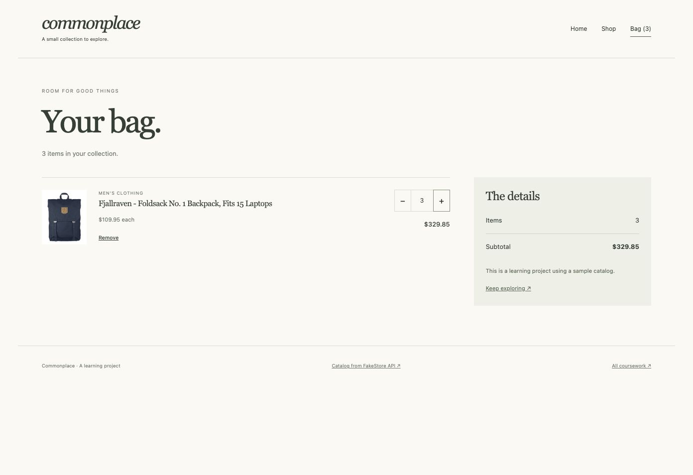

# The Odin Project — Coursework

This repository follows The Odin Project Full Stack JavaScript path: responsive HTML/CSS, JavaScript applications, React, SQL and Node.js.

## Why these projects
Each project explores a practical part of web development, from semantic forms and isolated game rules to state, data persistence and authenticated server routes. The collection is a record of learning by building and checking complete flows.

[Browse the portfolio](https://asliddintirkashev4-cloud.github.io/odin-intermediate-html-css/portfolio.html) or open the project files below.

## Projects
- `signup.html`: Fern & Field registration form. Semantic labels, required fields, email and length validation, password confirmation, blue focus states and invalid field styling. Local demo only; data is never submitted or stored.
- `dashboard.html`: Fieldwork admin dashboard. Nested CSS Grid layouts for the page, sidebar, header, projects, announcements and community. Search, favorites, preview dialogs and session-only project creation are working enhancements. Fictional profiles and concept cards are sample content.

## Practice
- `svg.html`: original shapes, viewBox scaling, inline SVG and linked SVG examples.
- `planets.html`: MDN planet table challenge, using the historical exercise dataset.

## Run
Open `index.html` or serve this folder with `python3 -m http.server 8765`. The static pages need no build step. Source projects such as React, Webpack and Node.js have their own dependency and run instructions.

## Assets
The forest and leaf SVG illustrations are original artwork created for these exercises. The sign-up wordmark uses Cormorant Garamond via Google Fonts, with Georgia as the offline fallback. No third-party photographs are included.

## Assignment references
- https://www.theodinproject.com/lessons/node-path-intermediate-html-and-css-sign-up-form
- https://www.theodinproject.com/lessons/node-path-intermediate-html-and-css-admin-dashboard
- https://www.theodinproject.com/lessons/node-path-intermediate-html-and-css-svg
- https://developer.mozilla.org/en-US/docs/Learn_web_development/Core/Structuring_content/Planet_data_table

Browser checks and publication status are tracked separately; this repository does not imply completion of the full Odin curriculum.

## Additional exercises
- `holy-basic.html`, `holy-responsive.html`, `holy-mockup.html`: CSS Grid exercises using The Odin Project starter markup. Starter license: `ODIN-EXERCISES-LICENSE`.
- `selectors-1.html` to `selectors-5.html`: solutions demonstrating MDN selector tasks with equivalent sample text and the required DOM relationships.
- `fonts.html`: the MDN starting page with locally hosted WOFF2 fonts and original CSS additions. Source: https://github.com/mdn/learning-area/tree/main/css/web-fonts . The source sample license is included as `MDN-SAMPLE-LICENSE.txt`; Zantroke’s font license is `ZANTROKE-LICENSE.txt`. Font files are the assets supplied with the MDN exercise.

## JavaScript
- `library.html`: Library project. The array of book objects is separate from rendering. Each book has a UUID; a prototype method toggles its reading status. Books can be added and removed by ID. State lasts for the current page session.
- `library-model.mjs`: Book class and collection functions.
- Run `node --test library.test.mjs` for model checks.
- `prototype-exercises.mjs`: four prototype-inheritance exercises; run with Node.js.

- `tictactoe.html`: local two-player Tic Tac Toe. Board state and player objects live in factories; an IIFE owns the display controller. All eight winning lines, draws, occupied squares and game-over behavior are covered by tests. Run `node --test tictactoe.test.mjs`.

## Restaurant Page
- `restaurant.html` and `restaurant.bundle.js`: production build of the three-view restaurant project.
- `restaurant/`: standalone Webpack source project, with dependencies, template, view modules and original SVG illustration.

## Todo List
- `todo.html`: projects, expandable and editable tasks, due dates, priorities and completion controls.
- `todo-model.mjs`: Todo class, project collections, validation and versioned localStorage persistence. Restored tasks regain their class methods.
- Run `node --test todo.test.mjs` for persistence, moving tasks between projects, deletion and validation checks.

## Algorithms and data structures
- `recursion-fibonacci.mjs`: iterative and recursive Fibonacci sequences. Values use JavaScript numbers; very large sequences exceed integer precision.
- `recursion-merge-sort.mjs`: recursive merge sort, preserving the input array.
- `linked-list.mjs`: nodes, list operations and optional indexed insertion/removal. Following the current assignment, `pop()` removes the head and accessors return values.
- `hash-map.mjs`: chained hash buckets, overwrite and removal, load-factor expansion, plus a HashSet.
- `binary-search-tree.mjs`: balanced construction, node-based insertion/deletion, four callback traversals, height/depth and rebalancing.
- `knights-travails.mjs`: breadth-first search over legal knight moves on an 8×8 board.
- Run `node algorithms-demo.mjs` for the assignment drivers and `node --test algorithms.test.mjs` for known examples, boundary cases, collision/resize behavior, tree mutation and shortest-path checks.

## Form validation
`validation.html` uses live inline Constraint Validation API checks for email, country-dependent postal codes and matching passwords. The form has `novalidate`; JavaScript checks every field, announces errors, and reports success locally. Library includes custom required-field errors developed on a feature branch.

`testing-practice/` contains the Jest/Babel project. Run `npm ci && npm test` inside that directory.

## Recursive methods practice
`factorial.js`, `contains.js`, `totalIntegers.js`, `permutations.js` and `pascal.js` solve the five official recursion exercises. The accompanying `.spec.js` files are the supplied tests with skipped cases enabled (43 tests). Exercise test license: `ODIN-EXERCISES-LICENSE`. Run them with Jest, for example `cd testing-practice && npm ci && npx jest --rootDir .. --testRegex "(factorial|contains|totalIntegers|permutations|pascal)\\.spec\\.js$" --runInBand`.

## Battleship
`battleship/` contains a complete browser game and its standalone Jest/Babel source project. Shuffle a legal fleet, start a game, attack the computer and play until a fleet sinks. The boards lock after a win. Model tests cover fleet placement, turns, repeated shots and both outcomes.

## API projects
- `weather.html`: Visual Crossing location forecasts, local Celsius/Fahrenheit conversion, weather themes, loading/error states and clearly labeled sample data. Enter your own key to request live data. The key is never hardcoded or saved. `weather-api.mjs` separates retrieval from normalization; `weather.test.mjs` tests normalization, URL encoding and error handling using controlled responses. Live forecasts were verified in the browser for Tashkent and London, including Celsius/Fahrenheit conversion. Each visitor supplies their own key.
- `giphy.html`: tagged GIF lookup, another-image button, promise chains and non-success HTTP handling. A GIPHY key is required. `giphy.test.mjs` checks response processing and errors using controlled responses. Live GIF verification remains pending a key.

## Advanced HTML and CSS
- `animation-button.html`: transform-only hover transition.
- `animation-popup.html`: sliding and fading modal, with reverse transition on close.
- `animation-menu.html`: top-origin keyframe expansion with an intermediate overshoot.
The animation starters come from The Odin Project CSS exercises; the starter license is included. Reduced-motion preferences disable the added movement.
- `portfolio.html`: responsive portfolio following the three Homepage assignment layouts, with an original SVG workspace illustration and actual project screenshots. Six projects link to their source and live pages. Contact links point to the public GitHub profile. No private contact details are published. The layout was checked in 320, 768 and 1920 px frames: one, two and three project columns respectively, with no horizontal overflow or missing images. A skip link, semantic sections, descriptive link names, image alternatives and visible focus styles support keyboard and assistive-technology use.

## React
- `react-cv/`: Papertrail CV Application. Components and styles live under `src/`; a source template and Vite configuration reproduce the production bundle. Saving displays HTML, editing restores values, and reversed experience dates are rejected.
- `react-memory/`: Pocket Recall. Twelve cards load from PokéAPI and shuffle on load and after every pick. Repeated picks lose; twelve unique picks win; the best score persists locally. Three rules tests and full browser win/loss flows pass.
- `react-shop/`: Commonplace. Home, shop and bag routes use React Router; a real FakeStore API catalog supplies products. Context and a reducer maintain cart quantities and integer-cent totals. Six React Testing Library flows and browser checks cover additions, edits, removal, filters, retry and route reload.
- `react-practice/`: routed component and state exercises, including named exports, live name fields, a background-change counter, editable class tasks with Count, nested context, recipient drafts and a useReducer-style hook built from useState. Three React Testing Library flows pass.

Each React directory contains its own package manifest and lockfile. Run `npm ci` and `npm run build` in that directory. The source template is `app.html`; its built output is published as `index.html` alongside the JS and CSS bundles. Relative asset paths and hash-based routes support Pages hosting.

## SQL
`sql/` contains verified SQL Teaching, SQLBolt and SQL Zoo queries and SQL Zoo quiz results.

## NodeJS
`node/` contains nine server projects, shared account validation, PostgreSQL migrations, seed scripts, integration tests and screenshots. See [the server workshop instructions](node/README.md). [Open the live server workshop](https://odin-server-workshop.onrender.com). The application runs on Render with PostgreSQL on Neon; GitHub Pages hosts the static coursework. Free Render instances can take about a minute to wake after inactivity.

## Portfolio and resume
`portfolio.html` introduces Asliddin Tirkashev and links to live coursework and source. `resume.html` is an accessible web resume; `resume.pdf` is the one-page PDF.
