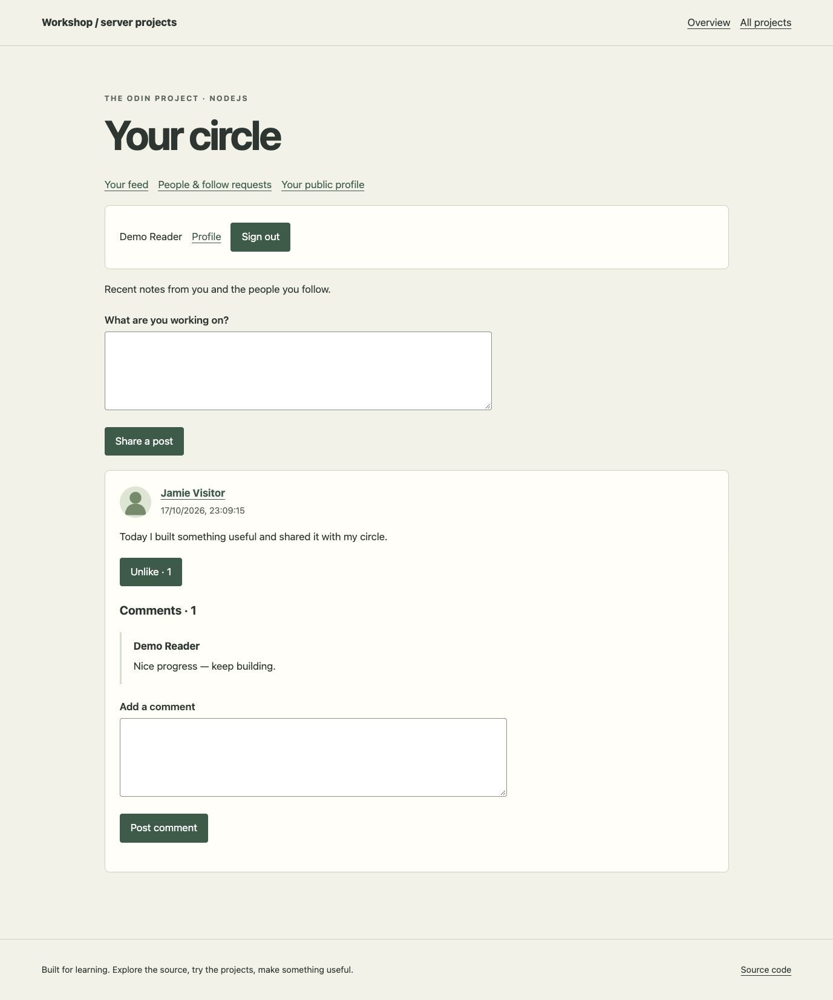
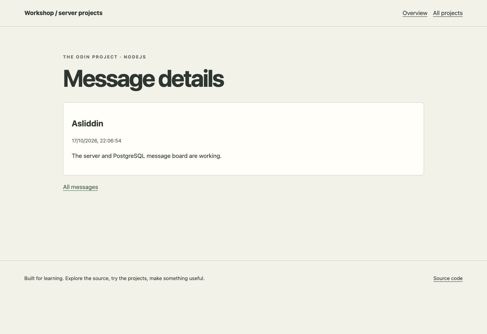
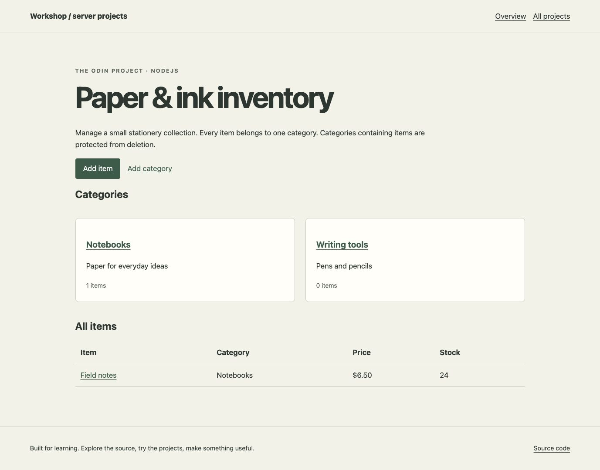
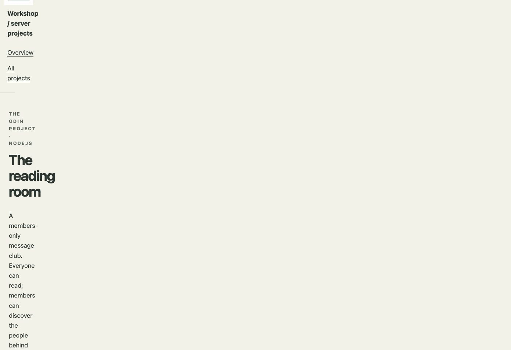
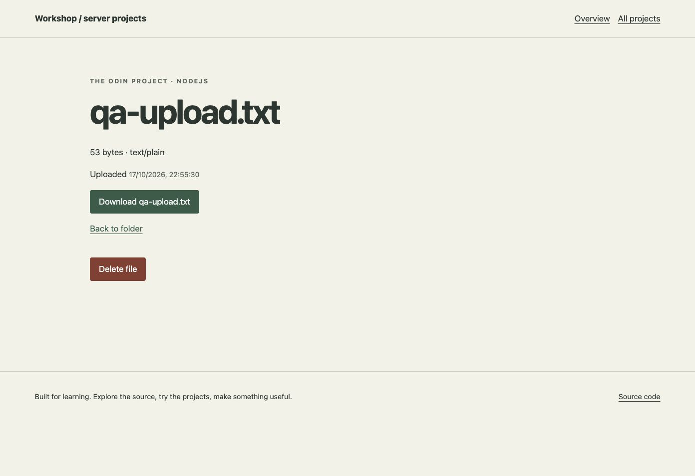
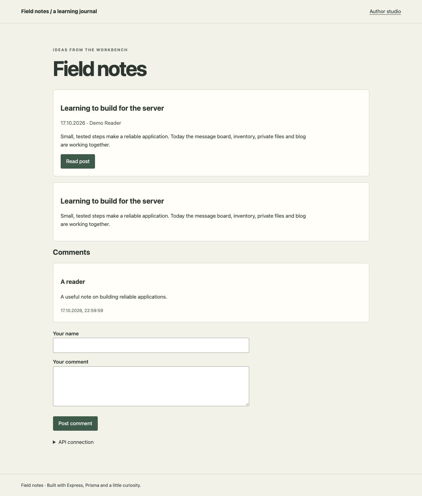
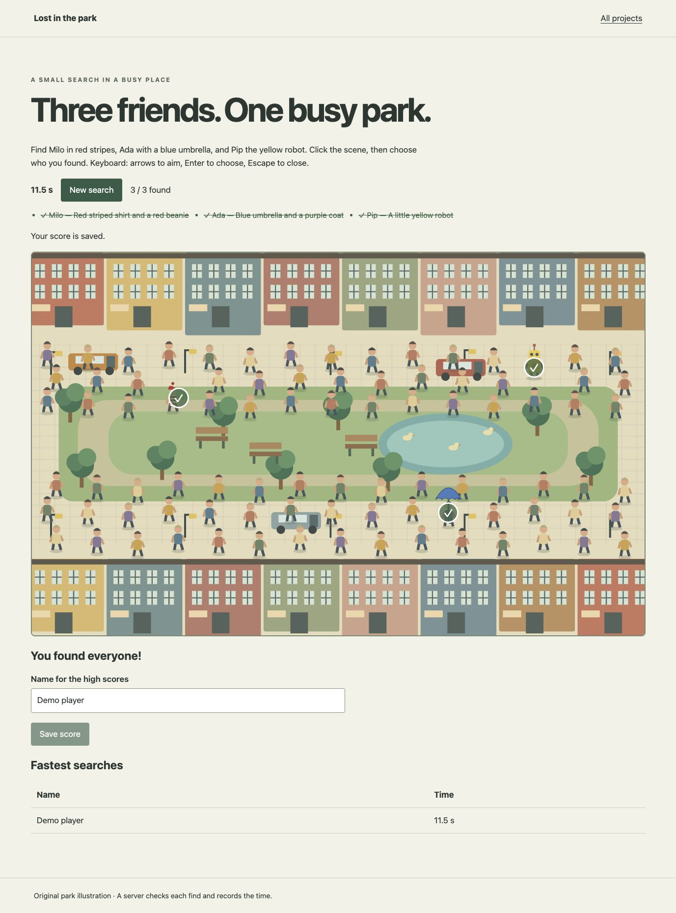
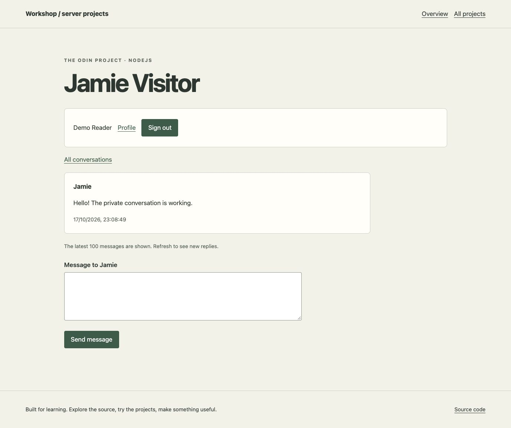

# Server workshop

Nine NodeJS course projects in one repository and one deployable Express process. Each project has its own router and pages. They share PostgreSQL, styling and account validation. A learning account works across the authenticated projects, with separate session cookies for each application.

## Why these projects

These exercises explore how a request becomes a useful application: routing, views, validation, data relations, authentication, authorization and testing. The individual projects build on one another while remaining easy to open from the workshop homepage.

## Run

Use Node 22.18 or later and PostgreSQL 16 or later.

1. Run `npm ci`.
2. Copy `.env.example` to `.env`, then enter your own database URL and random secrets. Do not commit `.env`.
3. Run `npm run prisma:generate` and `npm run prisma:migrate`.
4. Run `npm run db:setup` to add example board messages and stationery.
5. Run `npm start`, then open `http://localhost:8080`.

`SESSION_SECRET` and `JWT_SECRET` must each be at least 32 characters. Set different `MEMBERS_PASSCODE` and `ADMIN_PASSCODE` values. Author accounts can be created by joining Members Only with the administrator passcode, or by running `node --env-file=.env scripts/create-author.js` with `AUTHOR_EMAIL` and `AUTHOR_PASSWORD` environment variables. The script never overwrites an existing account.

## Projects

| Project | Route | Implementation |
| --- | --- | --- |
| Basic Informational Site | `/info/` | Native HTTP server in `basic-site/index.js`, Express rewrite, real 404 |
| Mini Message Board | `/board/` | Express/EJS, validated forms, details, PostgreSQL persistence |
| Inventory Application | `/inventory/` | Categories/items CRUD, restricted category deletion, admin passcode |
| Members Only | `/members/` | Passport Local, bcrypt, persistent sessions, membership and administrator roles |
| File Uploader | `/files/` | Prisma sessions, owned folders, validated uploads and authenticated downloads |
| Blog API | `/blog/api` | REST endpoints, JWT authors, drafts, publishing and comment moderation |
| Blog reader / author studio | `/blog/` / `/blog/author.html` | Independent static pages using fetch; API address can be configured |
| Photo Tagging App | `/hunt/` | Original SVG scene, normalized coordinates, server validation and timing, leaderboard |
| Messaging App | `/messages/` | Authenticated participant-only conversations and profile editing |
| Odin-Book | `/book/` | Accepted follow requests, filtered feed, posts, likes, comments and profile pictures |
| Lesson practice | `/practice/` | Routers, parameters, views, user CRUD, validation and SQL search |

## Data and access

- Raw SQL models use `pg` and parameterized queries. Later projects use Prisma with the PostgreSQL adapter.
- Migrations include application tables and explicitly named session tables. Seed scripts add example data without clearing existing records.
- Folders containing files cannot be deleted. Files must be removed first. Categories containing inventory items have the same restriction.
- Files are limited to 5 MB, checked for supported content, and served as attachments. `FILE_STORAGE=database` keeps bytes and metadata together in PostgreSQL. `FILE_STORAGE=local` implements the earlier filesystem version; use a persistent disk for that mode.
- The database storage option keeps this small exercise durable on hosts with an ephemeral filesystem, without requiring an additional storage account.
- Authenticated forms use CSRF tokens, HttpOnly/SameSite cookies and server-side authorization. Production cookies require HTTPS.
- Blog author tokens expire after one hour and are stored per API address in the author client's localStorage, as required by the assignment. `FRONTEND_ORIGINS` can restrict CORS to a comma-separated list of frontend origins.
- The photo search timer and completion checks are authoritative on the server; concurrent correct guesses lock the game row before updating it.
- The practice user and username lists are disposable examples, separate from authentication accounts. The lesson's `GET /practice/delete` route resets only demo usernames.

## Tests

Create a separate database with a name ending in `_test`, apply the migrations to it, then set `TEST_DATABASE_URL` in `.env`. Run `npm test`. Tests refuse a non-test database name. They cover HTTP routes, validation, persistence, roles, CSRF, JWTs, ownership, follows, private messages, duplicate likes and game completion.

Additional exercises: `node practice/node-basics.js` and `node --env-file=.env practice/prisma-basics.js`.

## Deployment

Use the included `render.yaml` with a PostgreSQL connection URL supplied as a secret. The build installs dependencies, generates Prisma, applies migrations and runs the idempotent seed script. `/health` checks the database connection. Use database file storage on hosts with ephemeral disks. Never publish connection URLs or passcodes.

## Screenshots

